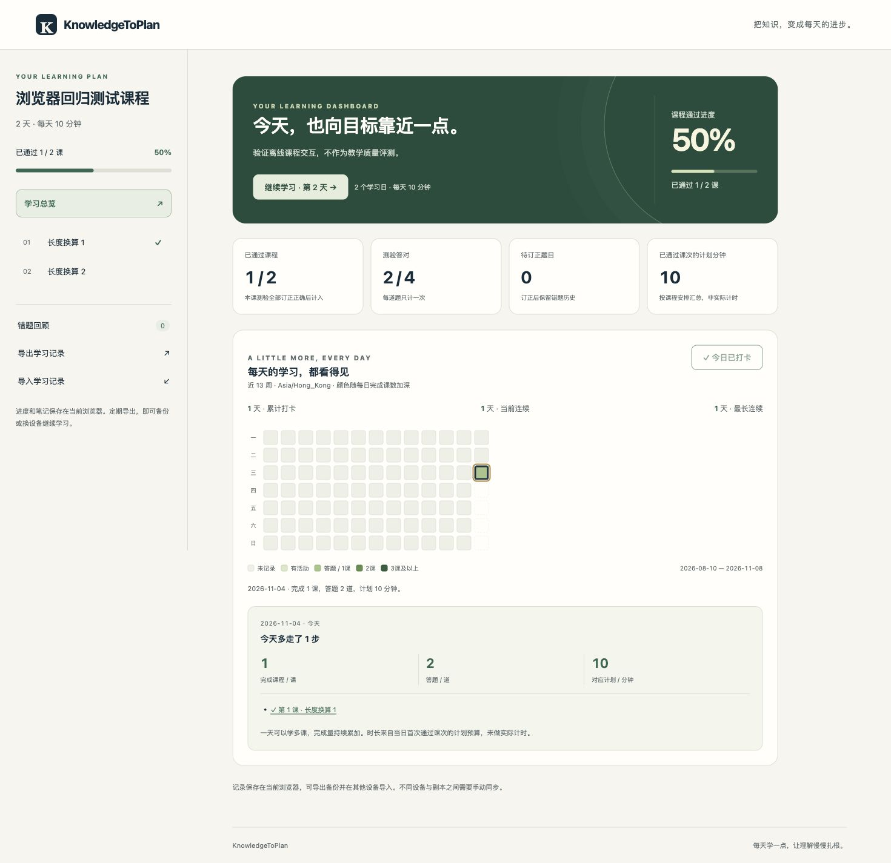
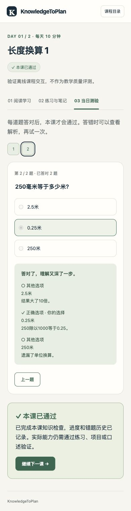

# KnowledgeToPlan

将资料或知识目标转为可执行的学习计划与自包含离线课程，结合学习基础、学习日数及每日时间预算评估是否可行。

课程包含知识讲解、练习笔记、带逐项解析的单选测验、错题回顾和进度备份。首页展示学习进度和近 13 周学习量地图；一天可以完成多课，点击日期可查看课程清单、唯一答题数和对应计划分钟。计划分钟不代表实际计时。

页面使用轻量动效，支持减少动态效果、手机布局和键盘操作。无需账户或外部字体、脚本；进度保存在当前浏览器，跨设备通过导出、导入接续。日历、云盘和在线发布按需连接。

涉及公式的内容须核对来源、符号、单位、适用条件、计算结果和实际排版；需要表达连接、方向、结构或流程时，配套必要示意图。模板支持原生 MathML、符号单位表和内嵌 SVG，标准见 [stem-content-standard.md](knowledge-to-plan/references/stem-content-standard.md)。

## 安装

下载 [打包文件](dist/knowledge-to-plan-2026-11-04.zip)，解压后将整个 `knowledge-to-plan` 文件夹放入 Codex 的 skills 目录（默认 `~/.codex/skills/`）。已有同名 skill 时先备份再替换。根目录的许可证和安装目录内的许可证保持一致。

也可以从本仓库安装 `knowledge-to-plan/` 子目录。在 Codex 中调用 `$knowledge-to-plan`，提供资料、目标、已有基础、学习天数与每天可用时间。

生成端要求 **Python 3.9+ 与可用的 IANA 时区数据**。3.9 是兼容下限，新安装请选仍受官方维护的 Python。建议在虚拟环境中先安装依赖：

```bash
python3 -m pip install -r knowledge-to-plan/requirements.txt
```

Windows 可相应使用 `python -m pip`。`tzdata` 提供系统缺少的时区数据；即使不生成 ICS，课程校验也需要它或系统数据库。错误信息会区分环境缺库与名称查找失败，且不会自动替换用户时区。详见 [运行环境说明](knowledge-to-plan/references/runtime-requirements.md) 和 [Python 官方说明](https://docs.python.org/3/library/zoneinfo.html#data-sources)。

学习者只需浏览器打开生成的 HTML，无需 Python、Node、依赖安装或服务器。进度需要定期导出；在线、离线和不同设备之间不自动同步。

## 查看演示

以下画面来自独立交互测试课程的真实 Chrome HTTP 验收，不是学习效果证明：



<details>
<summary>查看手机测验布局</summary>



</details>

下载或克隆仓库后，用浏览器打开 `knowledge-to-plan/assets/baseline/index.html`。演示含明确标注的示例数据和独立的空白试用；它们不会进入正式课程的生成流程。

公式与电路图示例位于 `knowledge-to-plan/assets/stem-example/index.html`；示例用于验证表达与图文对应，正式课程使用自己的资料与课程ID。

## 生成课程

先根据真实资料编写课程 JSON，结构见 [plan-schema.md](knowledge-to-plan/references/plan-schema.md)，界面和统计规则见 [dashboard-standard.md](knowledge-to-plan/references/dashboard-standard.md)。

```bash
python3 knowledge-to-plan/scripts/build_learning_site.py \
  --plan /absolute/path/plan.json \
  --output /absolute/path/output \
  --expected-days 30 \
  --expected-daily-minutes 30
```

把示例中的天数与分钟替换为事先约定的约束。生成结果为 `index.html` 和 `plan.json`，HTML 可直接离线打开。外部原文链接仍需网络。

重建演示：

```bash
python3 knowledge-to-plan/scripts/build_baseline.py
```

## 检查

生成器使用 Python 标准库与时区数据。Node.js 只用于开发测试：运行时测试与当前 Playwright 开发包以 Node 20+ 为兼容目标，建议新装仍受维护的 Node；学习页面没有 npm 运行依赖。完整环境与未验证范围见 [验证记录](docs/verification.md)。

```bash
python3 -m unittest discover -s knowledge-to-plan/scripts -p 'test_*.py'
node knowledge-to-plan/scripts/test_runtime.cjs
python3 -m unittest discover -s tools -p 'test_*.py'
python3 tools/check_examples.py
python3 tools/verify_release.py
```

测试覆盖预算与课程校验、测验通过规则、刷新恢复、旧备份兼容、课程时区与跨日、同日多课、题数去重、进度导入导出，以及动效与学习记录的隔离。测试不能代替教学内容与正确答案的事实核对。

压缩包校验值见 [SHA256SUMS](dist/SHA256SUMS)。

真实浏览器测试分别覆盖 HTTP、`file://`、桌面和 390px，运行方式与本机浏览器限制见 [E2E说明](tests/e2e/README.md)。配置了 CI 不代表 CI 已经执行成功；实际记录见上述验证记录。

## 教学内容评测

[evals](evals/README.md) 固定真实资料、学习目标、预算和参考核算，再让独立代理生成课程。原始输出保留，机械修订另存；程序校验、来源和答案复核、真人试学分别记录。未完成真人试学时，时间可行性仍是估计，不能报告教学效果已经通过。

首轮两个主题各生成两次，共36题；独立手写核算103项通过，已审范围未发现关键事实或答案错误。SI首次生成有一处复习引用类型错误，原稿与修订版分别保留。详细范围和限制见 [内容审阅报告](docs/content-review.md)，进度见 [实施状态](docs/implementation-status.md)。

## 发布与许可

原创代码、技能说明与原创示例采用 [MIT](LICENSE)；第三方原始资料保留自己的许可。不会因为引用某个网页就把其原文、图片或商标重新授权。离线安装包不包含评测原始网页或开发测试依赖。

版本与变更见 [CHANGELOG](CHANGELOG.md)。可用 [发布工具](tools/README.md) 重建确定性 ZIP，检查源码清单、示例、manifest 和校验值。后续正式版本可通过 [GitHub Releases](https://github.com/jordanyushen/knowledge-to-plan/releases) 分发；发布回执存在前，不把本地候选包称为已发布版本。
